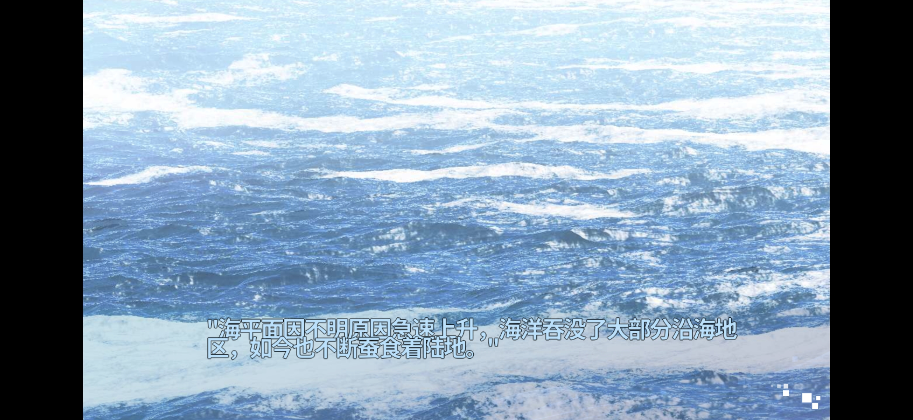
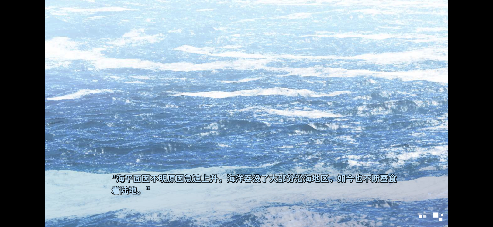
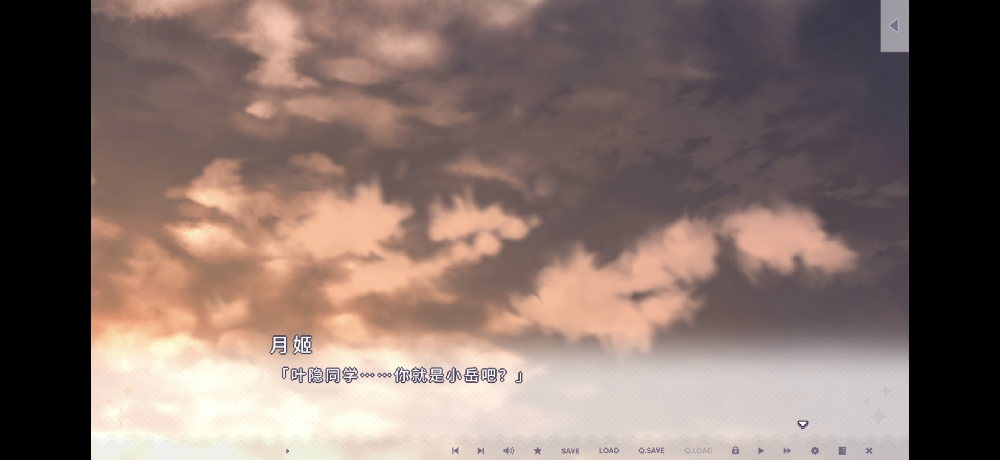
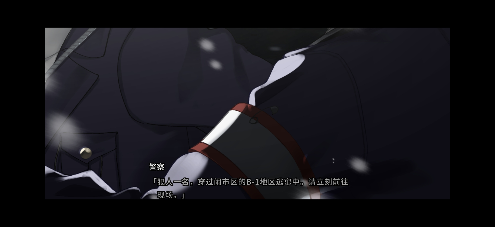
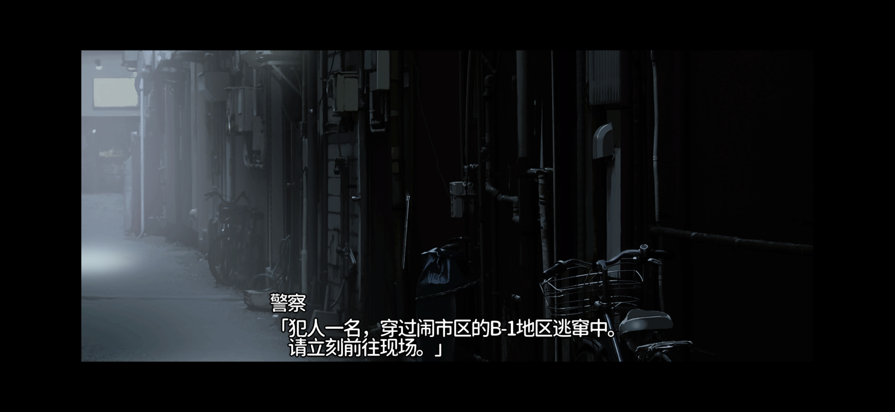

# Android 文本布局对比截图

提交者于 2026-10-08 提供这9张截图，并按文件名中的拍摄时间指定分组：1–3为修复后三个样本，4–6为修复前三个样本，7–9为官方内核三个样本。样本按组内顺序对应；保留原文件名和原始图像字节。

修复后画面是提交者确认文本渲染正常的 R8 集成版本；内核运行时代码对应 `e0937e02fa9b2422940ecef73773e55ab2ca64c9`。这些图片用于对照字号、横向间距、换行和上下行距；游戏场景可能处于不同动画时刻。后台恢复、系统音量及游戏语音的验收依据另见 PR 中的提交者测试报告，不能由静态截图推断。游戏内系统设置选项/YES-NO 无响应与延迟仍未解决且暂缓；这些图片不构成菜单验收。当前 PR 已撤回部分跨帧菜单等待候选，R8 图片不代表撤回后的整个源码已实机通过。

## 时间戳索引

|序号|样本|状态|原始文件|
|---|---|---|---|
|1|1|修复后|[Screenshot_2026-10-08-22-45-57-943_com.tyranor.next.jpg](Screenshot_2026-10-08-22-45-57-943_com.tyranor.next.jpg)|
|2|2|修复后|[Screenshot_2026-10-08-22-47-55-742_com.tyranor.next.jpg](Screenshot_2026-10-08-22-47-55-742_com.tyranor.next.jpg)|
|3|3|修复后|[Screenshot_2026-10-08-22-48-25-882_com.tyranor.next.jpg](Screenshot_2026-10-08-22-48-25-882_com.tyranor.next.jpg)|
|4|1|修复前|[Screenshot_2026-10-08-22-49-41-101_com.tyranor.next.jpg](Screenshot_2026-10-08-22-49-41-101_com.tyranor.next.jpg)|
|5|2|修复前|[Screenshot_2026-10-08-22-50-35-648_com.tyranor.next.jpg](Screenshot_2026-10-08-22-50-35-648_com.tyranor.next.jpg)|
|6|3|修复前|[Screenshot_2026-10-08-22-51-14-527_com.tyranor.next.jpg](Screenshot_2026-10-08-22-51-14-527_com.tyranor.next.jpg)|
|7|1|官方内核|[Screenshot_2026-10-08-22-51-49-189_com.tyranor.next.jpg](Screenshot_2026-10-08-22-51-49-189_com.tyranor.next.jpg)|
|8|2|官方内核|[Screenshot_2026-10-08-22-52-14-661_com.tyranor.next.jpg](Screenshot_2026-10-08-22-52-14-661_com.tyranor.next.jpg)|
|9|3|官方内核|[Screenshot_2026-10-08-22-52-40-646_com.tyranor.next.jpg](Screenshot_2026-10-08-22-52-40-646_com.tyranor.next.jpg)|

## 按样本比较

|样本|修复后|修复前|官方内核|
|---|---|---|---|
|1||||
|2||||
|3||||

附件仅为提交者提供的实机对比图，不作为测试夹具，不包含游戏包、脚本、官方引擎二进制或密钥。
